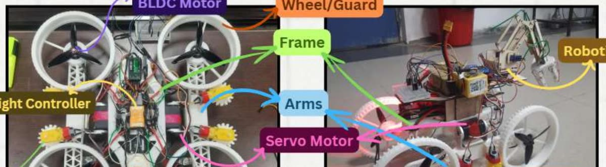
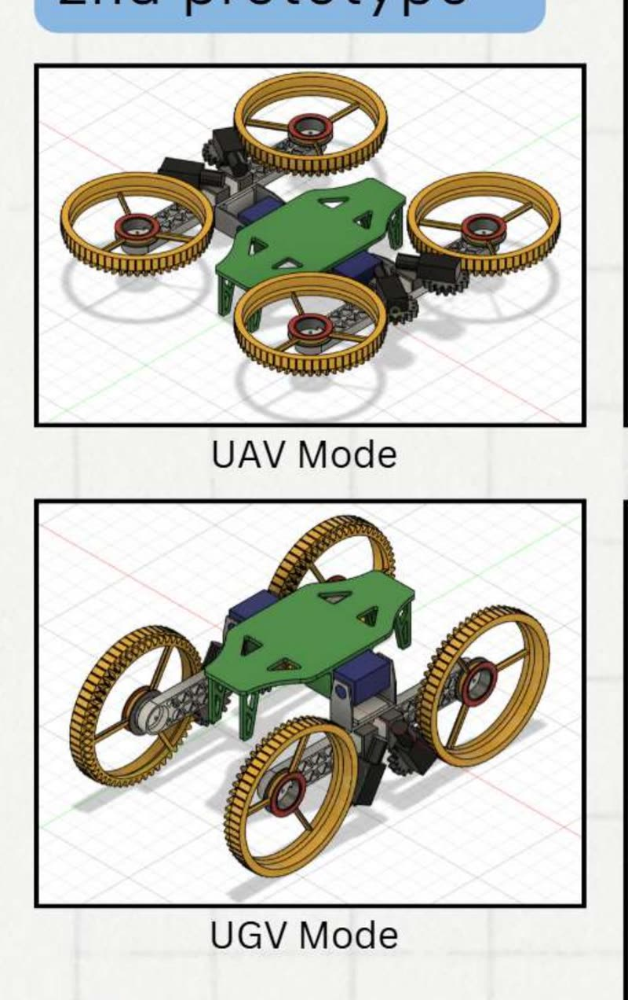

# Morphobot: reconfigurable drone–rover for disaster response

A quadrotor that flies to a site, lands, folds its rotor arms down and drives on its shrouded
prop-guards as wheels. A 4-axis arm actuated by shape-memory alloy, steered by hand gestures,
retrieves small objects.

> **Status:** CAD, analysis files and firmware are being cleaned up and will be added to this
> repository. Full write-up with video: **[kaunatharva.com/work/morphobot](https://kaunatharva.com/work/morphobot)**

  
  

## Why a drone that drives

Hovering costs energy continuously, so a battery that could drive a vehicle for an hour flies one
for a few minutes. Where the ground is drivable, Morphobot doesn't fly. The argument was made with
numbers: a three-stage LiPo discharge model (exponential, linear, inverse) in MATLAB, comparing
endurance on BLDC flight motors against geared DC drive motors.

## How it works

- **Air:** a quadrotor.
- **Ground:** the rotor arms fold down and the shrouded prop-guards become wheels, driven by geared
  DC motors through a gear train. Two 60 kg·cm servos handle the transition.
- **Arm:** 4 axes, actuated by shape memory alloy (three SMA springs in parallel, 5 V, 2.17 A),
  with a gripper steered by hand gestures through a vision pipeline. SMA was chosen because a
  disaster-response arm has to be light.

## Two prototypes

Both were analysed with FEA (static stress on arms, wheels and frame) and RANS CFD at 5 m/s. The
second prototype streamlined the wheel spokes:

| | Prototype 1 | Prototype 2 |
|---|---|---|
| Drag coefficient | 0.015 | **0.0082** |

Arms and wheels were printed in Hyper PLA on a carbon-fibre frame. FEA used ABS as a substitute
material, since Hyper PLA was not in the material library.

## Credit

The multi-modal morphing concept follows published work on appendage repurposing for locomotion
plasticity (Sihite et al., *Nature Communications*, 2023). This is an implementation of that idea
with an SMA manipulator added.

Built by **Atharva Chavan, Soham Mondal and Tejal Uplenchwar** under **Prof. I.A. Palani**,
Mechatronics and Instrumentation Lab, IIT Indore (2025).
